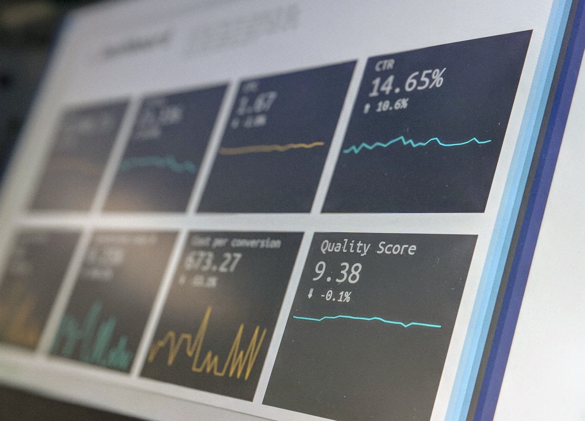
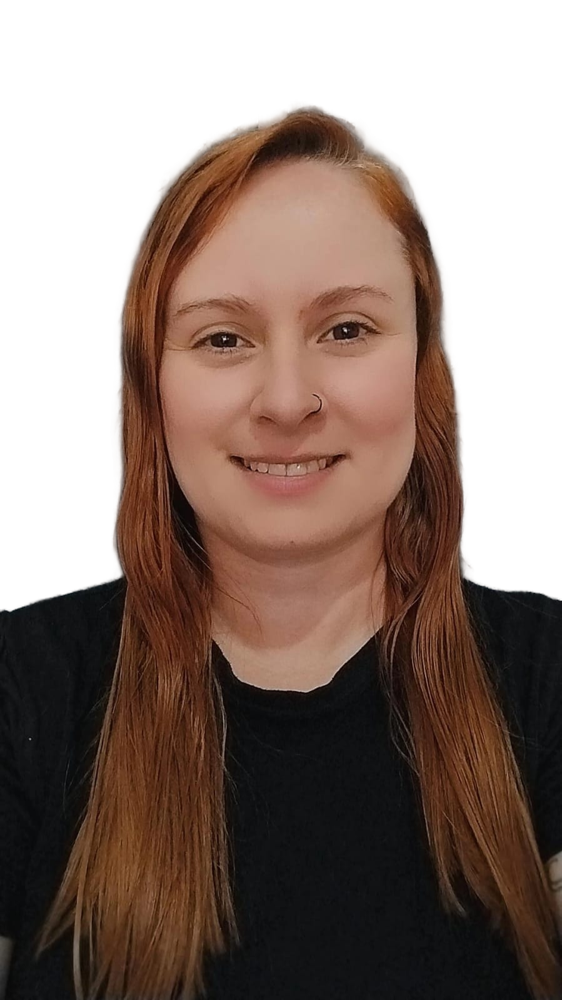
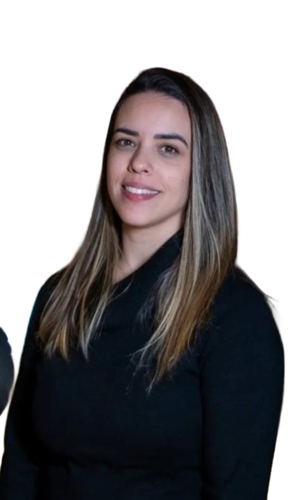
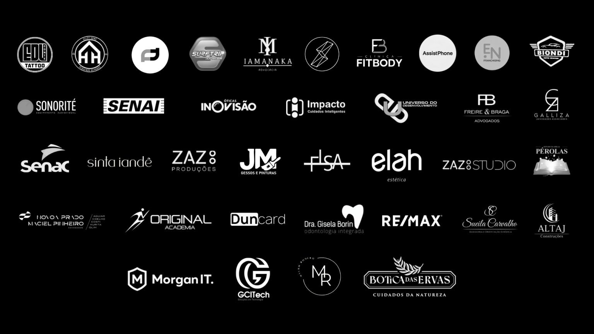
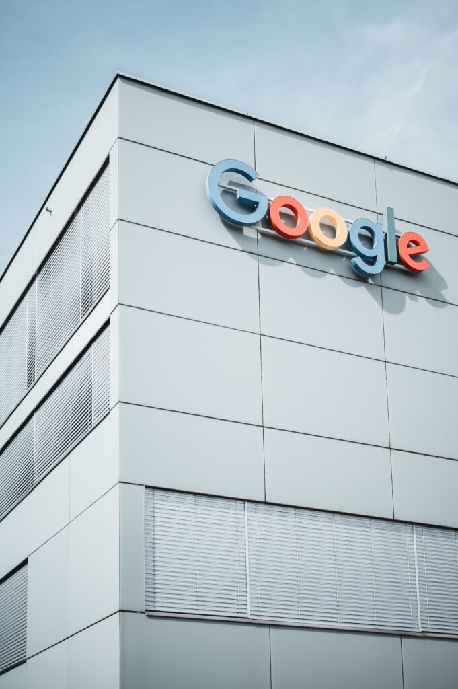
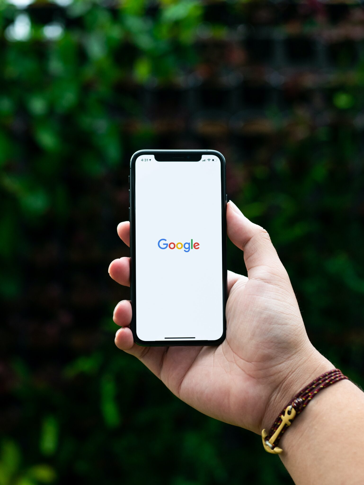
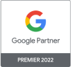

### Header

### hero

Somos a agência das agências
Não perca tempo procurando por aí. aqui você acha o que procura.Pode dizer para todo mundo: O que precisava, Achei!

logo do google
Equipe formada por quem já foi Googler
Revolucione sua empresa com quem entende do assunto.

### CTA

RS 1.000.000,00
Geridos em anúncio

1000
Empresas Revolucionadas

50
nichos diferentes atendidos

### Serviços
Nossas Soluções

Análise gratuita
Analisamos a conta da sua agência ou empresa, realizamos um diagnóstico de 10 pontos chave para identificar qual a melhor solução.
fale conosco

Suporte 360
Oferecemos suporte completo, trabalhando lado a lado com sua equipe. Realizamos uma auditoria detalhada (scrab) de sua conta e verificamos suas campanhas para garantir a eficiência e o alinhamento com os objetivos.
saiba mais

Consultoria
Acompanhamos toda a jornada do seu projeto, integrando esforços com sua equipe. Cada especialista foca em sua área para garantir que as ações sejam bem executadas e tragam resultados consistentes e mensuráveis.
saiba mais

Gestão
Cuidamos de suas campanhas do início ao fim. Assumimos o gerenciamento da conta, planejamos, executamos e acompanhamos os resultados. Tudo é apresentado em reuniões detalhadas para garantir transparência e alinhamento
saiba mais

Partners
Indicamos nossos parceiros caso precise de outras soluções. Sabemos que os resultados são fruto de um trabalho em conjunto.

### Diferenciais
Por que escolher a Achei?
Nosso foco é ajudar agências e seus clientes a alcançarem resultados sólidos no Google Ads, enquanto integramos esforços com outras áreas para garantir o sucesso em toda a jornada de marketing.

icones em primary-color

Expertise Comprovada
Nossa equipe já trabalhou diretamente com mais de 400 contas no Google, garantindo experiência e insights diferenciados.

Parceria Estratégica
Somos mais que uma agência de anúncios. Oferecemos suporte completo para você ter campanhas que realmente performam.

Indicações de Qualidade
Precisando de um especialista em outras áreas do marketing? Nós conectamos você aos melhores profissionais para construir uma estratégia completa e de alto impacto.

Foco em resultados reais
Nos dedicamos a entender seu cenário para oferecer soluções personalizadas, seja com a nossa equipe ou com nossos parceiros.

Equipe especializada
Contamos com especialistas certificados com conhecimento prático e técnico da ferramenta, e que saberão performar o que você precisa.

Acompanhamento contínuo
Não largamos sua mão: monitoramos o desempenho das estratégias e ajustamos continuamente para maximizar os resultados.

### Especialistas
Conheça nossa equipe

Alex
2 anos de experiência imersiva no Google

Jéssica
2 anos de experiência imersiva no Google

Luana
2 anos de experiência imersiva no Google

Dalete
7 anos de experiência em Relacionamentos e Parcerias

### Nossos clientes
Clientes que confiam em nós

### Depoimentos
O que nossos clientes e parceiros dizem

A Achei é uma grande
parceira, produzimos sites e
eles geram o trafego. Os
clientes sempre ficam
satisfeitos com os resultados.
Danilo
DEVSAMPA

A Achei entrega projetos
personalizados de
marketing, atendendo com
precisao os requisitos
necessários para alcançar os
resultados esperados,
suprindo as demandas da
equipe e dos clientes.
Kelmer
K2K AGÊNCIA
DIGITAL

Resultados incríveis! A Achei superou minhas expectativas em todo o projeto. Recomendo de olhos fechados!
Davi
SANTOS E
BUENO
ADVOGADOS

Excelentes resultados! A Achei nos ajudou em 3 meses a triplicar os
resultados, configurando nossa loja, direcionando nossos investimentos e melhorando nosso fluxo de clientes qualificados para conversão !!!
Denis       
SURFTRIP

A capacidade da Achei de
ajustar as estratégias de
Google Ads de forma precisa
e personalizada trouxe
resultados concretos,
superando as expectativas
tanto da nossa equipe
quanto de nossos clientes.

Haissa
BRIT

### Partners
Parceiros que trabalham conosco

### mentoria Ads Pro Accelerate

mude sua vida agora!
Você já conhece a mentoria Ads Pro Accelerate ?
Cansou de perder tempo e dinheiro com campanhas de Google Ads que não performam? A Mentoria Ads Pro Accelerate te ensina a dominar tráfego pago com estratégia validada por ex-Googlers, para você dobrar seu faturamento em 90 dias sem desperdiçar orçamento.

Quero conhecer a mentoria
Quero comprar a mentoria

### newsletter 
Inscreva-se e receba novidades!
Fique atualizado com as últimas tendências, dicas e novidades do mundo do marketing digital.

Nome
[Digite seu nome]

E-mail
[Digite seu e-mail]

Inscreva-se
[Ícone de seta para a direita]

### Faq
Qual é o foco principal da Achei Marketing Digital?
Nosso objetivo é criar uma rede de parcerias estratégicas que beneficiem tanto nossos parceiros quanto os clientes. Oferecer serviços especializados em Google Ads, ajudando agências que atendem clientes finais e não possuem domínio completo sobre a plataforma. Enquanto nós oferecemos as especialidades que encontramos através da nossa rede para os clientes que buscam outras soluções de marketing. 

Como vocês ajudam agências que já atendem clientes finais?
Trabalhamos como parceiros estratégicos, gerenciando campanhas de Google Ads e complementando sua oferta de serviços. Permitimos que você entregue mais valor aos seus clientes, sem precisar dominar a complexidade da ferramenta, da qual nós dominamos.

A Achei Marketing Digital oferece outros serviços além de Google Ads?
Nos especializamos em Google Ads, mas entendemos que o sucesso de uma campanha depende de um ecossistema de marketing funcionando. Por isso, indicamos profissionais confiáveis para áreas complementares, como criação de sites, branding e gestão de redes sociais.

Por que é importante ter outras áreas de marketing funcionando para o sucesso no Google Ads?
O Google Ads funciona melhor quando o cliente tem uma presença digital estruturada. Por exemplo, um site funcional, com boa usabilidade, é essencial para conversões. Da mesma forma, redes sociais ativas e um branding claro ajudam a fortalecer a comunicação da marca e ampliam o impacto das campanhas.

O que fazer se o cliente final não tiver um site ou presença online estruturada?
Caso seu cliente não tenha um site ou precise de melhorias, indicamos desenvolvedores especializados para criar uma estrutura otimizada e pronta para conversões. Também conectamos você a profissionais de branding e redes sociais para reforçar a comunicação da marca.

Como a experiência de vocês no Google agrega valor às campanhas?
Nossa equipe já trabalhou diretamente no Google, gerenciando mais de 400 contas. Essa experiência nos permite criar campanhas estratégicas, focadas em resultados, e evitar os erros mais comuns de iniciantes na plataforma.

O que significa uma estratégia de marketing 360°?
Uma estratégia de marketing 360° significa integrar todas as áreas essenciais do marketing para alcançar resultados consistentes. Com nossa ajuda no Google Ads e indicações de parceiros confiáveis, ajudamos a construir um ecossistema completo para seus clientes.

Como posso começar uma parceria com a Achei Marketing Digital?
É simples! Entre em contato conosco e agende sua análise gratuita para entender melhor suas necessidades e as dos seus clientes. Vamos criar uma proposta personalizada para gerenciar as campanhas de Google Ads enquanto apoiamos você em construir uma estratégia de marketing completa para nossos clientes em conjunto.

### Nossos valores
Missão
Oferecer orientação a empresas que procuram soluções de marketing digital. Atender de forma única e exclusiva agências e empresas que precisam melhorar sua performance em suas campanhas. Indicar nossos parceiros aos clientes que nos procuram para dizerem: “ACHEI a solução que eu precisava.”

Visão
Capacitar empresas a alcançarem visibilidade e relevância no ambiente digital, transformando conexões em resultados concretos e contribuindo para o sucesso sustentável dos negócios de nossos clientes. Acreditamos no poder da tecnologia e da criatividade para superar desafios, construir relacionamentos de valor e gerar impacto positivo no mercado.

Valores
Agimos com integridade, paixão pelo cliente e compromisso com a inovação contínua. Nossa dedicação ao foco no usuário, excelência e democracia digital é acompanhada por valores como crescimento sustentável, melhoria constante e equilíbrio entre seriedade e diversão, garantindo resultados sólidos e relações de confiança.

### contato

https://www.instagram.com/acheidigitalmarketing?igsh=NWRmZG9td3h3MmZo
https://www.linkedin.com/posts/achei-global-meta-digital_acheidigitalmarketing-marketingdigital-parceiros-activity-7259179968637665280-QDVg?utm_source=share&utm_medium=member_android
https://www.facebook.com/profile.php?id=100089154703467&mibextid=ZbWKwL

11 91870-2338
contato@acheidigitalmarketing.com.br

### footer 

### paleta 
#00AB4F primary e icones
gradiente de #00AB4F com branco e preto